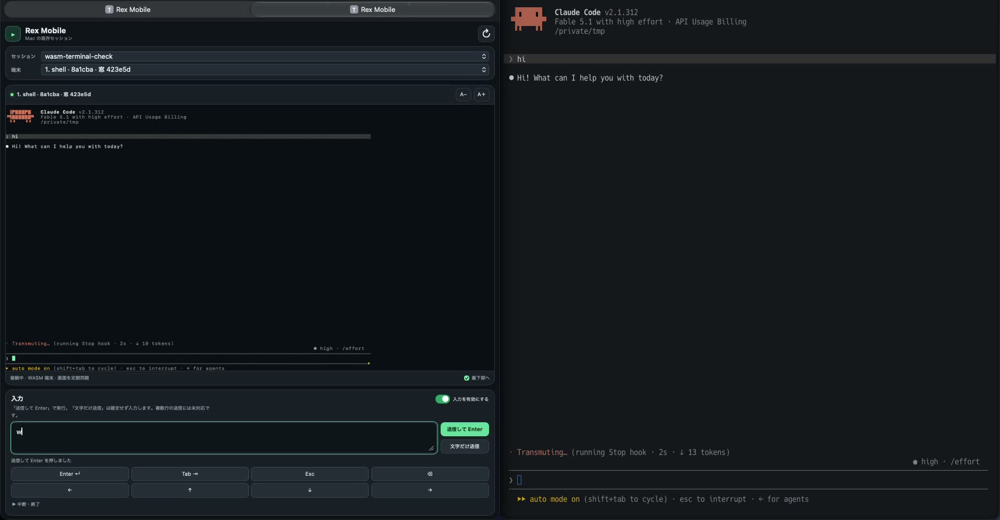

# Rex Mobile

An unofficial, personal browser client for existing [Rex](https://www.superlogical.com/rex/) terminal sessions on a Mac. A local Python bridge calls the Rex CLI; the page renders complete VT snapshots with [coder/ghostty-web](https://github.com/coder/ghostty-web) and its Ghostty based WASM. It refreshes about every two seconds while visible. This is neither a native Rex app nor an official Rex, Ghostty, or Coder project.

The page lets you choose a session and terminal, read its colors and cursor, and send text or keys to that same terminal. Input can run commands in the existing session. The server does not save terminal output or input. It does not support terminal mouse reporting, browser owned terminal resizing, or a continuous output stream. Snapshot capture and terminal size are separate Rex CLI reads, so a resize during capture may require another refresh.

## Demo

[](https://github.com/ekusiadadus/rex-mobile/releases/download/v0.1.0/rex-mobile-demo.mp4)

[Watch the 16-second demo](https://github.com/ekusiadadus/rex-mobile/releases/download/v0.1.0/rex-mobile-demo.mp4). Recorded with Screen Studio: Safari on the left and the same existing Rex session on the right. The recording is cropped to exclude browser addresses and the desktop menu bar; audio and source metadata are removed. This video demonstrates Mac Safari, rather than an iPhone device.

## Requirements

- macOS with Rex running and its CLI available.
- Python 3, Node.js, and npm for building the browser asset.
- Tailscale on the Mac and the device opening the page; Tailscale Serve with HTTPS enabled for the Mac.
- A private tailnet account whose `Tailscale-User-Login` value you can set as the owner.

## Set up

1. Clone this repository and build the pinned browser dependency:

   ```sh
   npm ci
   npm run build:terminal
   ```

   The build writes `static/vendor/terminal.bundle.js` and `static/vendor/ghostty-vt.wasm`. The browser loads them from this server, with no runtime CDN.

2. Choose the exact HTTPS origin Tailscale Serve will expose, including port `8443`, and the exact owner login. Set both variables before starting the server; it refuses to start when either is missing or invalid.

   ```sh
   export REX_MOBILE_ORIGIN='https://your-mac.your-tailnet.ts.net:8443'
   export REX_MOBILE_OWNER='you@example.com'
   python3 server.py
   ```

   The bridge uses `rex` from `PATH` if available. If needed, set `REX_BIN` to the absolute path of your Rex CLI. For a LaunchAgent, use the absolute CLI path because its `PATH` may differ from your shell.

3. In another terminal on the Mac, publish the loopback service to your tailnet:

   ```sh
   tailscale serve --bg --https=8443 http://127.0.0.1:8766
   ```

4. Open the origin from step 2 in Safari or another browser on a device signed in to the owner’s tailnet account. Keep the Mac awake, connected, and signed in to its user session.

The Python server binds only `127.0.0.1:8766`. Tailscale Serve terminates HTTPS on port `8443` and supplies the signed in user identity. The bridge checks that identity and the request host; input also requires the configured `Origin`. Do not use Tailscale Funnel or expose port `8766` to the public internet. Local processes on the Mac can reach the loopback server and can spoof HTTP headers, so this boundary is intended for remote tailnet users.

## Optional LaunchAgent

Copy `launchagent.plist.example` to `~/Library/LaunchAgents/com.personal.rex-mobile.plist`, then replace every `REPLACE_ME` value with your own origin, owner login, absolute Python path, absolute repository path, and absolute Rex CLI path. Create a directory for the chosen log files. Check the edited plist before loading it:

```sh
plutil -lint ~/Library/LaunchAgents/com.personal.rex-mobile.plist
launchctl bootstrap "gui/$(id -u)" ~/Library/LaunchAgents/com.personal.rex-mobile.plist
```

To restart after an update, run `launchctl kickstart -k "gui/$(id -u)/com.personal.rex-mobile"`. To stop HTTPS publishing, run `tailscale serve --https=8443 off`. To unload the agent, run `launchctl bootout "gui/$(id -u)" ~/Library/LaunchAgents/com.personal.rex-mobile.plist`.

## Use with Claude

If you want to return to a shell after leaving Claude, create a Rex session that starts a shell, then run `claude` inside it. Starting the Rex terminal with Claude as its main process can close the terminal when Claude exits. Sending `Ctrl C` or `Ctrl D` can interrupt or exit the program currently running in the selected terminal. Text-only send does not press Enter; “Send and Enter” does. The client does not retry a failed send automatically.

## Verify

```sh
python3 -m unittest -v
node --check static/app.js
npm run test:terminal
```

The current checkout has been checked in Mac Safari and through a dedicated Rex session over the HTTPS API. iPhone hardware behavior, including IME, rotation, and resume, has not been independently verified for this release.

## Licenses and upstream projects

Rex Mobile’s own code is MIT licensed; see [LICENSE](LICENSE). The distributed browser bundle includes `ghostty-web` and Ghostty based WASM; their separate MIT notices are in [THIRD_PARTY_NOTICES.md](THIRD_PARTY_NOTICES.md). Rex, Ghostty, Coder, Claude, and Tailscale names identify their respective projects and do not imply endorsement. No upstream logos or icons are included.

References: [Rex automation API](https://www.superlogical.com/rex/docs/automate/server-api), [Tailscale Serve](https://tailscale.com/docs/features/tailscale-serve), [ghostty-web](https://github.com/coder/ghostty-web).
